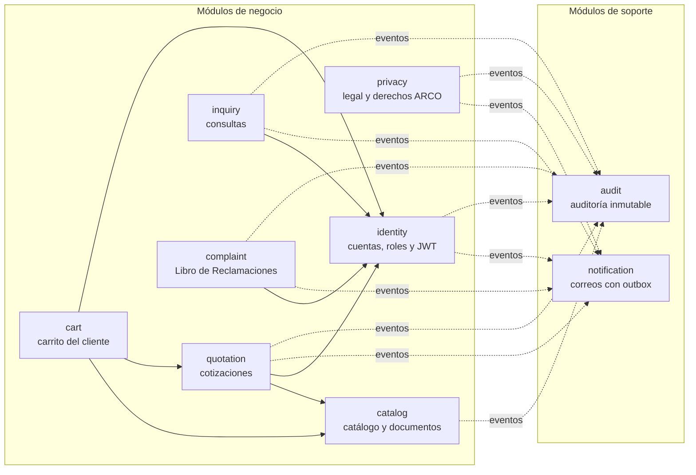

# FUNDIGSAC · Backend

API del sitio de FUNDIGSAC: catálogo técnico, cotizaciones B2B, consultas de contacto, Libro de Reclamaciones,
privacidad (Ley N.° 29733), cuentas de clientes y panel del personal.

> **Estado:** backend y base de datos completos y probados. **No está conectado al frontend todavía**: el sitio sigue
> funcionando con sus datos actuales. Los datos de demostración provienen del sitio y quedan marcados como no
> verificados (`dataVerified = false`) hasta que Ingeniería los valide.

## Arquitectura

**Monolito modular con DDD y arquitectura hexagonal.** Un solo despliegue, con módulos aislados que pueden separarse
como microservicios cuando haya una razón medible (arquitectura maestra §30.3). Spring Modulith verifica en cada
compilación que ningún módulo use el interior de otro.



Cada módulo (`src/main/java/com/fundigsac/<módulo>`) tiene las mismas capas:

| Capa | Contenido | Regla (verificada con ArchUnit) |
|---|---|---|
| `domain` | Agregados, valores e invariantes de negocio (la lógica de negocio) | Java puro: sin Spring, JDBC, Jackson ni Servlet |
| `application` | Casos de uso, transacciones, autorización por permiso | No conoce la web ni los adaptadores |
| `infrastructure` | Adaptadores JDBC (SQL explícito), JWT, SMTP | Implementa los puertos del dominio y la aplicación |
| `web` | Controladores REST y DTO validados | No accede a la base de datos |
| `api` | Contrato público del módulo (interfaces y eventos) | Lo único que otros módulos pueden usar |

La comunicación entre módulos es por **eventos de dominio** guardados en la misma transacción (registro de
publicaciones de Spring Modulith = *transactional outbox*) y por interfaces `api` explícitas. Para extraer un módulo
como servicio basta externalizar sus eventos a un broker; los JWT se firman con RSA, así que otro servicio los valida
solo con la clave pública.

## Tecnología

| | Versión |
|---|---|
| Java | 21 LTS (código) sobre JRE 25 LTS (imagen Docker) |
| Spring Boot / Spring Security / Spring Modulith | 4.1.1 / 7.1.1 / 2.1.1 |
| PostgreSQL | 18.6 (Alpine) |
| Migraciones | Flyway 12 |
| Documentación de la API | OpenAPI 3.1 (springdoc 3.1.1) |
| Pruebas | JUnit 5, Testcontainers 2, ArchUnit, Awaitility |

Versiones estables verificadas en Maven Central y Context7 el 16/10/2026.

## Levantar en local

Requisitos: Docker Desktop y Git Bash (incluye `openssl`).

```bash
sh scripts/generate-secrets.sh
```

```bash
docker compose up -d --build
```

| Servicio | URL |
|---|---|
| API y Swagger UI | http://localhost:8080/swagger-ui.html |
| Correos enviados (Mailpit) | http://localhost:8025 |
| PostgreSQL | Solo dentro de Docker (red interna). `docker compose exec postgres psql -U fundigsac_admin -d fundigsac` |

El administrador inicial es `admin@fundigsac.local`; su contraseña está en `secrets/bootstrap_admin_password`. En
Swagger: `POST /api/v1/auth/login`, copie `accessToken` y péguelo en **Authorize**.

Prueba de humo de todos los flujos principales contra el entorno en marcha:

```bash
sh scripts/smoke-test.sh
```

## Endpoints (83 operaciones, prefijo `/api/v1`)

| Grupo | Endpoints |
|---|---|
| Pública (18) | `catalog/categories`, `catalog/products` (filtros `q`, `category`, `family`, `joint`, `dn`, `pn`, `homologation`, `sector`), `catalog/products/{slug}`, `catalog/filters`, `catalog/sectors`, `resources`, `resources/{slug}/download`, `POST quotes`, `quotes/{folio}/receipt`, `POST complaints`, `complaints/{folio}/receipt`, `POST inquiries`, `legal/{type}`, `POST privacy/consents`, `POST privacy/requests` |
| Acceso y cuenta (21) | `auth/register`, `verify-email`, `login`, `refresh`, `logout`, `password/forgot`, `password/reset`, `invitation/accept`; `account/me`, `account/password`, `DELETE account`, `account/quotes`; `cart`, `cart/items`, `cart/submit` |
| Personal (44) | Bandejas de `quotes`, `inquiries`, `complaints` y `privacy/requests` (asignar, estados, responder); `catalog/products` y `catalog/documents` (borrador → revisión → publicación); `users` (invitar, roles, desactivar); `legal/{type}/versions`; `audit`; `notifications` |

Convenciones: errores RFC 9457 (`application/problem+json`) con `code`, `errors[]` y `requestId`; los formularios
públicos aceptan `Idempotency-Key` (un reintento devuelve el mismo folio); las modificaciones del personal exigen
`If-Match` con el `ETag` del registro (428 si falta, 412 si cambió); paginación `page`/`size` (máximo 100).

## Seguridad

- **Autenticación:** JWT RS256 de 15 minutos más refresh token opaco rotativo. Si se reutiliza un refresh token, se
  revoca toda la familia. Los JWT llevan un sello de seguridad que invalida los tokens en segundos al cambiar la
  contraseña, los roles o el estado de la cuenta.
- **Contraseñas:** Argon2id con los parámetros de OWASP y política NIST (12 a 128 caracteres, rechaza contraseñas
  comunes o que contengan el correo). Tras 5 intentos fallidos, la cuenta se bloquea 15 minutos.
- **Sin enumeración de cuentas:** registro y recuperación responden siempre igual; el inicio de sesión tarda lo mismo
  aunque la cuenta no exista.
- **Autorización:** RBAC con permisos finos (`quote:manage`, `catalog:publish`…) en cada caso de uso y autorización
  por objeto (una cotización ajena responde 404). La publicación de fichas exige que la revise una persona distinta de
  quien la envió (cuatro ojos).
- **Entrada:** validación en la web y en el dominio; los campos desconocidos se rechazan (evita la asignación masiva
  de atributos); cuerpo máximo de 64 KB; trampa *honeypot* contra bots; límites por IP (token bucket) en formularios,
  inicio de sesión y recuperación.
- **Cabeceras:** CSP `default-src 'none'`, HSTS, `X-Frame-Options: DENY`, `nosniff`, `Referrer-Policy: no-referrer`,
  CORP/COOP y Permissions-Policy. CORS cerrado a orígenes configurados. Todo lo no declarado se niega.
- **Datos personales:** constancias con token HMAC y datos enmascarados; los correos se borran de la bandeja al
  enviarse; los logs no guardan cuerpos ni datos personales; el consentimiento de cookies se guarda sin IP ni
  identificadores de seguimiento.
- **Contenedores:** usuario sin privilegios, sistema de archivos de solo lectura, `cap_drop: ALL`,
  `no-new-privileges` y límites de memoria. Los secretos van como Docker secrets (nunca en el repositorio). La base de
  datos queda en una red interna sin salida a Internet y actuator solo en el puerto interno 8081.

## Base de datos

Diez migraciones versionadas (`src/main/resources/db/migration`), una por módulo, en el esquema `fundigsac`:

- **Roles separados:** `fundigsac_migrator` (dueño del esquema, solo Flyway) y `fundigsac_app` (solo DML). Además, la
  aplicación **no puede** modificar ni borrar `audit_events`, historiales, hojas de reclamación ni textos legales.
- **Reglas en la base de datos:** `CHECK` de estados y formatos (folios, RUC, slugs, SHA-256), unicidad, claves
  foráneas sin borrado en cascada de registros con valor legal y un *trigger* que impide reescribir lo presentado en el
  Libro de Reclamaciones.
- **Folios correlativos** por tipo y año (`COT`, `REQ`, `CON`, `REC`, `ARC`) asignados en la misma transacción: sin
  huecos ni duplicados.
- **Búsqueda** de texto completo en español (sin tildes y por raíz) con índices GIN; IDs UUIDv7.
- **Datos iniciales** (solo perfiles `local` y `test`): 8 categorías, 94 productos, 658 variantes, 4 sectores,
  9 documentos (3 PDF con SHA-256 real) y los textos legales vigentes. Se generan desde el sitio con
  `node scripts/seed/generate-catalog-seed.mjs`, que lee la carpeta hermana `../Frontend`.

## Pruebas

```bash
./mvnw verify
```

- 37 pruebas unitarias y de arquitectura (reglas de dominio, valores, límites de módulos y capas).
- 37 pruebas de integración con PostgreSQL 18 real en Testcontainers (requiere Docker): flujos completos, seguridad,
  idempotencia, concurrencia optimista, eventos, correos y protecciones de la base de datos.

## Antes de producción

- Conectar el frontend (recomendado: un BFF en Next.js que guarde los tokens en cookies `HttpOnly`).
- PostgreSQL administrado con TLS (`sslmode=verify-full`), respaldos y restauración probada.
- Proveedor SMTP transaccional (SPF, DKIM y DMARC) y gestor de secretos.
- Con varias instancias, los límites por IP deben pasar a un almacén compartido (Bucket4j sobre PostgreSQL o Redis).
- Validar con Legal el plazo de respuesta del Libro (15 días hábiles por defecto) y cargar los feriados en
  `fundigsac.complaints.holidays`.
- Validar con Ingeniería los datos técnicos del catálogo antes de marcarlos como verificados.
- Fuera de alcance a propósito: pedidos y pagos (Izipay), que dependen de los gates comerciales G05 a G10.
