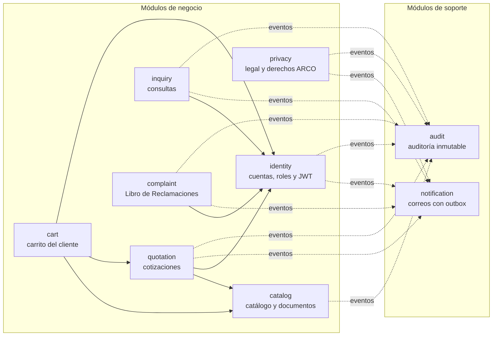

# FUNDIGSAC · Backend

[](https://github.com/FundigSac/Backend/actions/workflows/ci.yml)

API del sitio de FUNDIGSAC: catálogo técnico, cotizaciones B2B, consultas de contacto, Libro de Reclamaciones,
privacidad (Ley N.° 29733), cuentas de clientes y panel del personal.

> **Estado:** backend y base de datos completos, probados y **conectados en local** con el sitio (carpeta
> `../Frontend`) y el panel del personal (`../Admin`), ambos a través de un BFF en Next.js con cookies
> `HttpOnly`. Sin `BACKEND_URL`, el sitio y el panel siguen funcionando como antes (envío por correo o WhatsApp y
> datos de demostración). Los datos del catálogo provienen del sitio y quedan marcados como no verificados
> (`dataVerified = false`) hasta que Ingeniería los valide.

## Arquitectura

**Monolito modular con DDD y arquitectura hexagonal.** Un solo despliegue, con módulos aislados que pueden separarse
como microservicios cuando haya una razón medible (arquitectura maestra §30.3). Spring Modulith verifica en cada
compilación que ningún módulo use el interior de otro.



Cada módulo (`src/main/java/com/fundigsac/<módulo>`) tiene las mismas capas:

| Capa | Contenido | Regla (verificada con ArchUnit) |
|---|---|---|
| `domain` | Agregados, valores e invariantes de negocio (la lógica de negocio) | Java puro: sin Spring, JDBC, Jackson ni Servlet |
| `application` | Casos de uso, transacciones, autorización por permiso | No conoce la web ni los adaptadores |
| `infrastructure` | Adaptadores JDBC (SQL explícito), JWT, SMTP | Implementa los puertos del dominio y la aplicación |
| `web` | Controladores REST y DTO validados | No accede a la base de datos |
| `api` | Contrato público del módulo (interfaces y eventos) | Lo único que otros módulos pueden usar |

La comunicación entre módulos es por **eventos de dominio** guardados en la misma transacción (registro de
publicaciones de Spring Modulith = *transactional outbox*) y por interfaces `api` explícitas. Para extraer un módulo
como servicio basta externalizar sus eventos a un broker; los JWT se firman con RSA, así que otro servicio los valida
solo con la clave pública.

## Tecnología

| | Versión |
|---|---|
| Java | 21 LTS (código) sobre JRE 25 LTS (imagen Docker) |
| Spring Boot / Spring Security / Spring Modulith | 4.1.1 / 7.1.1 / 2.1.1 |
| PostgreSQL | 18.6 (Alpine) |
| Migraciones | Flyway 12 |
| Documentación de la API | OpenAPI 3.1 (springdoc 3.1.1) |
| Pruebas | JUnit 5, Testcontainers 2, ArchUnit, Awaitility |

Versiones estables verificadas en Maven Central y Context7 el 16/10/2026.

## Levantar en local

Requisitos: Docker Desktop y Git Bash (incluye `openssl`).

```bash
sh scripts/generate-secrets.sh
```

```bash
docker compose up -d --build
```

| Servicio | URL |
|---|---|
| API y Swagger UI | http://localhost:8080/swagger-ui.html |
| Correos enviados (Mailpit) | http://localhost:8025 |
| PostgreSQL | Solo dentro de Docker (red interna). `docker compose exec postgres psql -U fundigsac_admin -d fundigsac` |

El administrador inicial es `admin@fundigsac.local`; su contraseña está en `secrets/bootstrap_admin_password`. En
Swagger: `POST /api/v1/auth/login`, copie `accessToken` y péguelo en **Authorize**.

Prueba de humo de todos los flujos principales contra el entorno en marcha (incluye el acceso del personal con el
código que llega a Mailpit):

```bash
sh scripts/smoke-test.sh
```

### Todo integrado (sitio + panel + API)

El navegador nunca llama a la API: el sitio y el panel la usan desde su propio servidor (BFF), reenvían la IP del
visitante (`FORWARD_HEADERS_STRATEGY=native`, solo desde redes internas) y guardan los tokens en cookies `HttpOnly`
firmadas que solo viajan a sus rutas `/api`.

| App | Variables | Arranque |
|---|---|---|
| Sitio (`../Frontend`, :3000) | `BACKEND_URL=http://localhost:8080`, `AUTH_SECRET` (y `GOOGLE_CLIENT_ID`/`SECRET` para Google) | `npx next dev --port 3000` |
| Panel (`../Admin`, :3110) | `NEXT_PUBLIC_DATA_SOURCE=backend`, `BACKEND_URL=http://localhost:8080`, `ADMIN_AUTH_SECRET` | `npx next dev --port 3110` |
| API (este repositorio) | `.env` opcional con `GOOGLE_CLIENT_ID` (el mismo del sitio) para el ingreso con Google | `docker compose up -d --build` |

- **Sitio:** registro, verificación por correo, ingreso, recuperación de contraseña, Google, cotizaciones (con folio y
  constancia), consultas, Libro de Reclamaciones, solicitudes de eliminación y consentimiento de cookies.
- **Panel:** el personal entra **sin contraseña** con un código de 6 dígitos que llega al correo
  (`POST /auth/staff/code` y `/code/verify`: 10 minutos, un solo uso, 5 intentos, 60 s entre envíos). Ve el directorio
  de todas las cuentas con indicadores y actividad, invita personal, corrige datos, suspende, reactiva, anonimiza y
  atiende las colas de cotizaciones, consultas, reclamaciones y privacidad.
- **Límites por IP en local:** sin un proxy de confianza todas las peticiones llegan desde la misma IP; si se prueban
  muchos formularios seguidos aparece 429 (5 cada 10 minutos). `docker restart fundigsac-backend-1` vacía los
  contadores.

## Endpoints (prefijo `/api/v1`)

| Grupo | Endpoints |
|---|---|
| Pública | `catalog/categories`, `catalog/categories/{slug}`, `catalog/products` (filtros `q`, `category`, `family`, `joint`, `dn`, `pn`, `homologation`, `sector`), `catalog/products/{slug}`, `catalog/filters`, `catalog/sectors`, `resources`, `resources/{slug}`, `resources/{slug}/download`, `POST quotes`, `quotes/{folio}/receipt`, `POST complaints`, `complaints/{folio}/receipt`, `POST inquiries`, `legal/{type}`, `legal/{type}/versions`, `POST privacy/consents`, `POST privacy/requests` |
| Acceso y cuenta | `auth/register`, `verify-email`, `verify-email/resend`, `login`, `google`, `staff/code`, `staff/code/verify`, `refresh`, `logout`, `password/forgot`, `password/reset`, `invitation/accept`; `account/me`, `account/password`, `DELETE account`, `account/quotes`; `cart`, `cart/items`, `cart/submit` |
| Personal | `accounts` (directorio de clientes y personal con filtros y conteos, `stats`, `activity`, ficha, corrección de datos, desactivar, reactivar, reenviar verificación, enlace de contraseña, notas internas, anonimizar); bandejas de `quotes`, `inquiries`, `complaints` y `privacy/requests` (asignar, estados, responder); `catalog/products` y `catalog/documents` (borrador → revisión → publicación); `users` (invitar, roles, desactivar, reactivar); `profile`; `legal/{type}/versions`; `audit`; `notifications` (reintento) |

Convenciones: errores RFC 9457 (`application/problem+json`) con `code`, `errors[]` y `requestId`, documentados en el contrato
OpenAPI de cada operación (esquema `Problem`); los formularios
públicos aceptan `Idempotency-Key` (un reintento devuelve el mismo folio); las operaciones del personal que cambian un
registro versionado exigen `If-Match` con su `ETag` (428 si falta, 412 si cambió); paginación `page`/`size` (máximo 100).

Operaciones del personal sin `If-Match`, porque no sobrescriben un registro versionado: las altas (`POST users`,
`catalog/products`, `catalog/documents` y `legal/{type}/versions`), la nota interna (`PUT accounts/{id}/notes`, se guarda
en una tabla aparte y gana la última escritura), el reintento de un correo (`POST notifications/{id}/retry`, protegido por
su estado: 409 si ya no está fallido) y los envíos de correo (`POST accounts/{id}/verification-email` y `/password-reset`).

Los filtros `family` y `sector` son datos del catálogo: un valor desconocido devuelve una lista vacía. `joint` es una lista
cerrada: un valor desconocido responde 400. Un parámetro con el carácter U+0000 responde 400 (`INVALID_CHARACTER`).

## Seguridad

- **Autenticación:** JWT RS256 de 15 minutos más refresh token opaco rotativo. El personal entra sin contraseña con un
  código de un solo uso enviado al correo (solo se guarda su hash) y los clientes también pueden entrar con Google: la
  API valida el ID token con las claves públicas de Google (emisor, audiencia y `email_verified`). Si se reutiliza un refresh token, se
  revoca toda la familia. Los JWT llevan un sello de seguridad que invalida los tokens en segundos al cambiar la
  contraseña, los roles o el estado de la cuenta.
- **Contraseñas:** Argon2id con los parámetros de OWASP y política NIST (12 a 128 caracteres, rechaza contraseñas
  comunes o que contengan el correo). Tras 5 contraseñas erróneas el ingreso con contraseña se bloquea 15 minutos. Ese
  bloqueo no afecta al acceso del personal con código, y una cuenta sin contraseña no acumula fallos, para que un anónimo
  no pueda dejar fuera a nadie.
- **Sin enumeración de cuentas:** registro y recuperación responden siempre igual; el inicio de sesión tarda lo mismo
  aunque la cuenta no exista o no tenga contraseña.
- **Cuentas creadas con Google:** no tienen contraseña; confirman `DELETE account` y `POST account/password` con un ID token
  de Google reciente del mismo sujeto (`googleIdToken`).
- **Autorización:** RBAC con permisos finos (`quote:manage`, `catalog:publish`…) en cada caso de uso y autorización
  por objeto (una cotización ajena responde 404). La publicación de fichas exige que la revise una persona distinta de
  quien la envió (cuatro ojos).
- **Entrada:** validación en la web y en el dominio; los campos desconocidos se rechazan (evita la asignación masiva
  de atributos); cuerpo máximo de 64 KB; trampa *honeypot* contra bots; límites por IP (token bucket) en formularios,
  inicio de sesión y recuperación.
- **Cabeceras:** CSP `default-src 'none'`, HSTS, `X-Frame-Options: DENY`, `nosniff`, `Referrer-Policy: no-referrer`,
  CORP/COOP y Permissions-Policy. CORS cerrado a orígenes configurados. Todo lo no declarado se niega.
- **Datos personales:** constancias con token HMAC y datos enmascarados; los correos se borran de la bandeja al
  enviarse; los logs no guardan cuerpos ni datos personales; el consentimiento de cookies se guarda sin IP ni
  identificadores de seguimiento.
- **Contenedores:** usuario sin privilegios, sistema de archivos de solo lectura, `cap_drop: ALL`,
  `no-new-privileges` y límites de memoria. Los secretos van como Docker secrets (nunca en el repositorio). La base de
  datos queda en una red interna sin salida a Internet y actuator solo en el puerto interno 8081.

## Base de datos

Quince migraciones versionadas (`src/main/resources/db/migration`) en el esquema `fundigsac`: una por módulo (V1 a
V10) y las de la integración (V11 códigos de acceso del personal, V12 Google, V13 origen del alta y boletín, V14
búsqueda sin tildes, V15 notas internas):

- **Roles separados:** `fundigsac_migrator` (dueño del esquema, solo Flyway) y `fundigsac_app` (solo DML). Además, la
  aplicación **no puede** modificar ni borrar `audit_events`, historiales, hojas de reclamación ni textos legales.
- **Reglas en la base de datos:** `CHECK` de estados y formatos (folios, RUC, slugs, SHA-256), unicidad, claves
  foráneas sin borrado en cascada de registros con valor legal y un *trigger* que impide reescribir lo presentado en el
  Libro de Reclamaciones.
- **Folios correlativos** por tipo y año (`COT`, `REQ`, `CON`, `REC`, `ARC`) asignados en la misma transacción: sin
  huecos ni duplicados.
- **Búsqueda** de texto completo en español (sin tildes y por raíz) con índices GIN; IDs UUIDv7.
- **Datos iniciales** (solo perfiles `local` y `test`): 8 categorías, 94 productos, 658 variantes, 4 sectores,
  9 documentos (3 PDF con SHA-256 real) y los textos legales vigentes. Se generan desde el sitio con
  `node scripts/seed/generate-catalog-seed.mjs`, que lee la carpeta hermana `../Frontend`.

## Pruebas

```bash
./mvnw verify
```

- Pruebas unitarias y de arquitectura: reglas de dominio, valores, límites de módulos y capas, sello de seguridad, validación
  de los ID token de Google, carga de claves JWT y envío de correos.
- Pruebas de integración con PostgreSQL 18 real en Testcontainers (requiere Docker): flujos completos, permisos de cada
  operación con cada rol, `If-Match`, límites de frecuencia, peticiones simultáneas, roles de la base de datos y arranque con
  `application-prod.yml`. Cubren las 97 operaciones y cada respuesta real se compara con el contrato
  OpenAPI: código de estado documentado, tipo de contenido y esquema del cuerpo.
- Las fechas de negocio se calculan en hora de Lima: CI ejecuta además la suite con la JVM en UTC+14
  (`-Duser.timezone=Pacific/Kiritimati`).
- JaCoCo se ejecuta dentro de `verify` y rompe la compilación por debajo de 95 % de líneas, 95 % de métodos y 80 % de ramas.
  Informe en `target/site/jacoco/index.html`. Las clases y los métodos se ejecutan en orden aleatorio.

Colección de Postman con los flujos públicos, de acceso, de cuenta y del personal contra el entorno en marcha (no publica
nada en la nube de Postman):

```bash
sh postman/run.sh
```

## Antes de producción

- Publicar la API (y su base de datos) en un servidor y cargar `BACKEND_URL` en los proyectos de Vercel del sitio y del
  panel; hoy la integración corre en local con Docker.
- PostgreSQL administrado con TLS (`sslmode=verify-full`), respaldos y restauración probada.
- Proveedor SMTP transaccional (SPF, DKIM y DMARC) y gestor de secretos.
- Con varias instancias, los límites por IP deben pasar a un almacén compartido (Bucket4j sobre PostgreSQL o Redis).
- Validar con Legal el plazo de respuesta del Libro (15 días hábiles por defecto) y cargar los feriados en
  `fundigsac.complaints.holidays`.
- Validar con Ingeniería los datos técnicos del catálogo antes de marcarlos como verificados.
- Fuera de alcance a propósito: pedidos y pagos (Izipay), que dependen de los gates comerciales G05 a G10.
